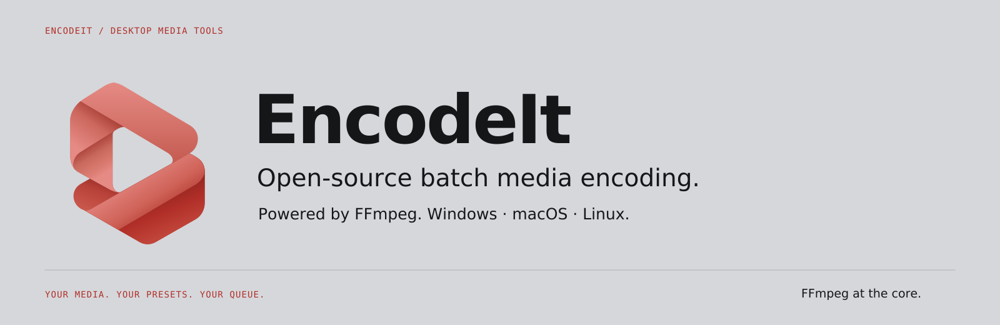
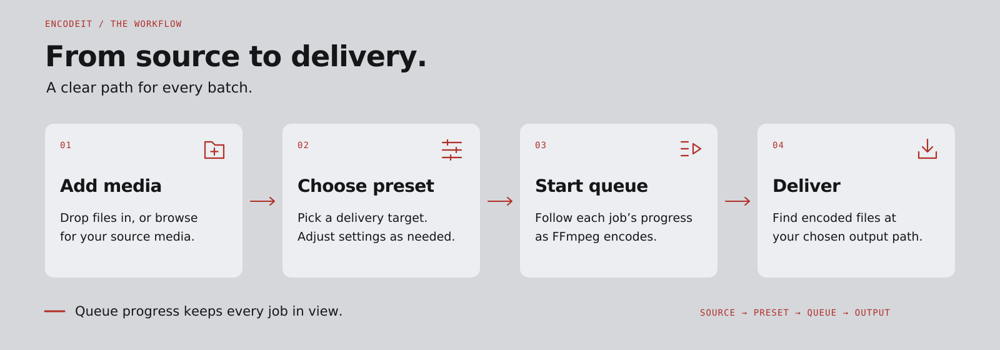
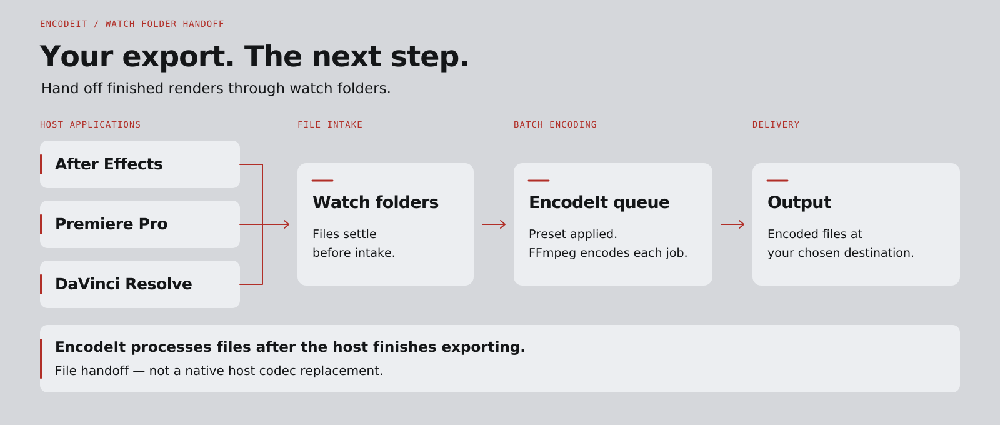

<p align="center">
  <picture>
    <source media="(prefers-color-scheme: dark)" srcset="docs/assets/readme-banner-dark.svg">
    <source media="(prefers-color-scheme: light)" srcset="docs/assets/readme-banner-light.svg">
    
  </picture>
</p>

# EncodeIt

Open-source batch media encoder with a queue and preset browser, powered by FFmpeg.

Cross-platform (**Windows, macOS, Linux**) via Electron + FFmpeg.

## Workflow

<p align="center">
  <picture>
    <source media="(prefers-color-scheme: dark)" srcset="docs/assets/workflow-dark.svg">
    <source media="(prefers-color-scheme: light)" srcset="docs/assets/workflow-light.svg">
    
  </picture>
</p>

## Phase 1

- Encoding queue with progress, start/stop, multi-select
- Preset browser grouped by delivery target (social, broadcast, mezzanine, and more)
- Unified format/codec catalog with open FFmpeg mappings
- Watch folders
- Hardware encode options (NVENC / QSV / AMF / VideoToolbox) when FFmpeg supports them

### Requirements

- Node.js 20+
- FFmpeg/FFprobe are **bundled** (downloaded on `npm install` / `npm run download-ffmpeg` and shipped inside installers via `extraResources`)

### Develop

```bash
npm install
npm run dev
```

### Scripts

```bash
npm run typecheck
npm run catalog:stats
npm run build
```

### Catalog notes

Proprietary certified wrappers (full Dolby Vision packages, DCP packaging, certified AS-11 metadata, disc authoring) are **not** claimed. Broadcast formats use best-effort FFmpeg recipes labeled in the catalog.

## Phase 2 — host integrations

<p align="center">
  <picture>
    <source media="(prefers-color-scheme: dark)" srcset="docs/assets/integrations-dark.svg">
    <source media="(prefers-color-scheme: light)" srcset="docs/assets/integrations-light.svg">
    
  </picture>
</p>

| Integration | Location | Mechanism |
| --- | --- | --- |
| **Watch folders** (primary) | Preferences → Integrations | Detects AE / Resolve / Premiere; Standard sets up only installed apps; Custom picks among them |
| Local intake API | Preferences → Integrations (`127.0.0.1:47821`) | Optional `POST /queue/add`, `GET /presets`, inbox |
| After Effects | [`integrations/after-effects`](integrations/after-effects) | Watch folder; optional ExtendScript / CEP |
| Premiere Pro | [`integrations/premiere`](integrations/premiere) | Watch folder or ExtendScript |
| DaVinci Resolve | [`integrations/davinci-resolve`](integrations/davinci-resolve) | Watch folder; optional Python |

**Shipped:** persistent watch folders UI, intake API, AE CEP packaging (`npm run package:cep`).  
**Later:** Premiere native exporter, automated ZXP signing in CI.

```bash
# Optional: queue a file via intake while EncodeIt is running
curl -X POST http://127.0.0.1:47821/queue/add \
  -H "Content-Type: application/json" \
  -d '{"paths":["/path/to/clip.mp4"],"presetId":"h264-match-source-high-bitrate","start":true}'
```

Documentation artwork notes: [`docs/GRAPHICS.md`](docs/GRAPHICS.md).
