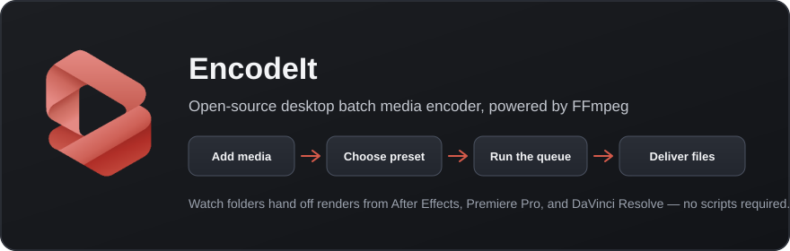

# EncodeIt — User guide

In-app: **Help → Documentation** (or press **F1**).

<p align="center">
  
</p>

---

## Overview



EncodeIt is a batch media encoder with an queue and preset browser powered by FFmpeg.

Add media, choose a preset, start the queue, and FFmpeg encodes each job. Watch folders let After Effects, Premiere Pro, and DaVinci Resolve hand off renders without scripts.

---

## Quick start

1. Click **Add Source…** (`Ctrl+O`), or drag files onto the window.
2. Select a preset in the Preset Browser (or keep the default).
3. Confirm the output path in Encoding / Source · Output if needed.
4. Click **Start Queue** (`Ctrl+Enter`).
5. Watch progress in the queue. Use **Stop** (`Ctrl+.`) to cancel.

---

## Queue

- Each row is one encode job: source, preset, status, and progress.
- Multi-select jobs to change preset, output path, or export tracks together.
- **Clear Done** removes finished jobs from the list.
- Output files go to each job’s output path.

> **Note:** Default output folder is Videos (Windows) or Movies (macOS) → `EncodeIt` → `Output`.

---

## Presets & formats

The Preset Browser groups presets by delivery target — social, broadcast, mezzanine, and more.

Presets map to open FFmpeg recipes for common delivery targets.

> **Note:** Proprietary certified wrappers (full Dolby Vision packages, DCP packaging, certified AS-11, etc.) are not claimed. Broadcast options are best-effort FFmpeg mappings.

---

## Encoding options

- **Encoding panel** — quick edits for the selected job(s): export video/audio, resolution, frame rate, bitrate/CRF, audio codec, output path, and hardware acceleration.
- **Export Settings…** — full AME-style dialog for deeper video/audio/advanced options. Open it from:
  - the Encoding panel button
  - clicking the **Preset** or **Format** cell on a queue row
  - **Edit → Export Settings…**
- Changing settings writes **per-job overrides** on top of the chosen preset. A **custom** badge appears on the queue when overrides differ from the preset.
- **Save as Custom Preset** in Export Settings stores a reusable preset under the **User** group in the Preset Browser (delete with the × next to the name).
- Applying a different preset to a job clears overrides.
- Multi-select jobs before opening Export Settings to apply the same overrides to all selected waiting jobs.
- **Hardware** — NVENC, QSV, AMF, or VideoToolbox when bundled FFmpeg and your GPU support them.
- **Preferences → Hardware** — see what was detected on this machine.
- **Preferences → General** — default output folder, max concurrent encodes (1–8), and overwrite behavior.
- If overwrite is off, jobs fail when the output file already exists.
- Hardware encodes that fail may automatically retry with software encoding.

---

## Workspace

- Dock, split, and undock panels in a flexible workspace layout.
- Drag a panel header to tear it off or drop it on another edge.
- **View → Dock All Panels** / **Show All Panels** restores visibility.
- **Media Browser** browses folders and can add media to the queue.

---

## Watch folders

Watch folders automatically queue new media that appears in a directory. This is the primary way After Effects, Premiere Pro, and DaVinci Resolve hand work to EncodeIt — no scripts required.

### How to set one up

1. Open **Edit → Preferences → Integrations** to see install paths and active watches.
2. Each watch has a folder path, a preset used for new files, and an encode output folder.
3. Keep EncodeIt running while the host app finishes writing the file.
4. When a new media file appears and its size stays stable across polls, it is added to the queue with that watch’s preset.
5. Per watch: enable/disable, auto-start queue, and optional subfolder watching.

> **Note:** Files already in the folder when you add or enable a watch are ignored — only new arrivals are queued. Incomplete writes are held until size settles. **Help → Open Log File** shows the app log. The queue is restored after restart.

---

## Host integrations overview

EncodeIt integrates with After Effects, Premiere Pro, and DaVinci Resolve by watching shared folders. Point each host’s render/export destination at the matching folder; EncodeIt picks up finished files and encodes them with FFmpeg presets.

### Install modes

On install (or first launch), EncodeIt detects which host apps are installed on disk. They do **not** need to be running for detection.

- **Standard** — creates folders and watches only for detected apps.
- **Custom** — choose After Effects, DaVinci Resolve, and/or Premiere Pro yourself (even if not installed yet).

### Folder layout

| Folder | Host destination |
| --- | --- |
| `from-ae` | After Effects Output Module / render output |
| `from-resolve` | DaVinci Resolve Deliver destination |
| `from-premiere` | Premiere Pro export / Media Export location |
| `Output` | Default EncodeIt encode output |

| Platform | Root path |
| --- | --- |
| Windows | `%USERPROFILE%\Videos\EncodeIt\` |
| macOS | `~/Movies/EncodeIt/` |

### Shared setup steps

1. Install EncodeIt (or complete first-launch integration setup) so the folders exist.
2. Confirm paths under **Edit → Preferences → Integrations**.
3. In the host app, set render/export output to the matching `from-*` folder.
4. Leave EncodeIt running, then render/export as usual.
5. New files appear in the EncodeIt queue; **Start Queue** if it is not already running.

> **Note:** EncodeIt does not replace AE/Premiere/Resolve codecs or Deliver UI. It encodes **after** the host writes a file. Optional scripts/CEP for one-off sends live in the GitHub `integrations/` folder.

---

## After Effects

Recommended workflow: render compositions into the EncodeIt `from-ae` watch folder. No scripts or panels required.

### Watch-folder workflow

1. Confirm `from-ae` exists (**Preferences → Integrations**). Typical path: Videos/Movies → `EncodeIt` → `from-ae`.
2. In After Effects, open **Composition → Add to Render Queue** (or use the Render Queue panel).
3. Set the Output Module’s output file into the `from-ae` folder.
4. Use a high-quality intermediate in AE when you want EncodeIt to handle delivery codecs (ProRes, DNx, high-bitrate H.264, etc.).
5. Keep EncodeIt running, then **Render**. When the file finishes writing, it is queued automatically.

### Tips

- Change the preset for AE handoffs under **Preferences → Integrations** on the `from-ae` watch.
- Finished encodes go to the watch’s output folder (default: `EncodeIt` → `Output`).
- If you already rendered elsewhere, copy/move the finished file into `from-ae` while EncodeIt is watching — or use **Add Source…**.

### Optional scripts & CEP

> **Note:** GitHub `integrations/after-effects` includes `SendToEncodeIt.jsx` and a CEP panel that talk to the Host intake API for one-off sends without a watch folder. Enable AE Scripting network access if you use them.

---

## DaVinci Resolve

Resolve does not allow replacing Deliver codecs with a third-party encoder. The supported path is **Deliver** into the EncodeIt `from-resolve` folder, then let EncodeIt re-encode for delivery.

### Deliver workflow

1. Confirm `from-resolve` exists (**Preferences → Integrations**). Typical path: Videos/Movies → `EncodeIt` → `from-resolve`.
2. In Resolve, open the **Deliver** page and set Filename / Location to that folder.
3. Choose a high-quality master or intermediate in Deliver (e.g. ProRes, DNxHR, or a high-bitrate mezzanine) — EncodeIt will create the final delivery formats.
4. **Add to Render Queue** and **Start Render** while EncodeIt is running.
5. When Deliver finishes writing, EncodeIt queues the new file with the `from-resolve` watch preset.

### Tips

- Adjust the Resolve watch preset and encode output under **Preferences → Integrations**.
- You can Deliver multiple timelines into `from-resolve`; each new file becomes its own queue job.
- Wait for Deliver to complete before expecting a queue entry.

### Optional Python helpers

> **Note:** GitHub `integrations/davinci-resolve` has Python helpers (`send_to_encodeit.py`, `resolve_deliver_handoff.py`) for intake API / Utility script workflows when you do not want a watch folder. Host intake must be enabled.

---

## Premiere Pro

Recommended workflow: export sequences into the EncodeIt `from-premiere` watch folder. EncodeIt then applies FFmpeg presets for batch delivery.

### Export workflow

1. Confirm `from-premiere` exists (**Preferences → Integrations**). Typical path: Videos/Movies → `EncodeIt` → `from-premiere`.
2. In Premiere, use **File → Export → Media** (or the Export panel).
3. Set the Output Name / location to the `from-premiere` folder.
4. Export a master or mezzanine you are happy to re-encode from, or export the delivery format you want EncodeIt to process further.
5. Keep EncodeIt running, then **Export**. When the file finishes, it appears in the EncodeIt queue.

### Tips

- Export to disk into `from-premiere` — no third-party encoder panel required.
- Change the Premiere watch preset under **Preferences → Integrations**.
- Batch: export several sequences into `from-premiere`; each completed file is queued separately.

### Optional ExtendScript

> **Note:** GitHub `integrations/premiere` includes `SendToEncodeIt.jsx` for one-off handoff via the Host intake API / inbox. Enable Premiere scripting network access if you use it.

---

## Host intake API (optional)

Optional localhost API for scripts and tools (**Preferences → Integrations**).  
Default base URL: `http://127.0.0.1:47821`

### Endpoints

| Endpoint | Purpose |
| --- | --- |
| `GET /health` | Check that intake is running |
| `GET /presets` | List preset ids and names |
| `POST /queue/add` | Queue paths; optional `presetId` and `start` |

### Example & inbox

Example body:

```json
{
  "paths": ["D:/renders/clip.mov"],
  "presetId": "h264-match-source-high-bitrate",
  "start": true
}
```

A JSON inbox folder (shown in Preferences) is also polled for dropped job files.

---

## Updates & uninstall

### Checking for updates

- **Preferences → Updates → Check for updates** enables automatic checks on launch and about once a day (on by default).
- The bottom status bar is always visible; it shows the app version, and update actions when a newer release exists.
- **Download…** opens the release in your browser — nothing is downloaded automatically.
- **Not now** clears the update notice for that version until a newer one ships.
- **Help → Check for Updates…** or Preferences → Updates → **Check now** runs a check immediately.

### Installing a newer version

- **Windows Setup** detects an existing EncodeIt install, replaces the app files with the new version, and **keeps** settings / queue / media by default. On the host-integrations page, check **Clean install** to wipe previous settings and plugins instead (you will be asked whether to also delete media folders).
- **macOS PKG** upgrades in place the same way. If previous EncodeIt data is found, the installer offers **Keep Settings** (default) or **Clean Install**.
- **Linux .deb** upgrades in place and keeps data by default. With a GUI session (zenity), install can offer **Clean Install**; or set `ENCODEIT_CLEAN_INSTALL=1` before `dpkg`/`apt`.
- **DMG / portable / AppImage**: replace the app file; settings stay in Application Support / AppData. Use Help → Uninstall (or the uninstall scripts) before replacing if you want a wipe.

### Uninstalling completely

- **Help → Uninstall EncodeIt…** removes settings, logs, custom presets, workspaces, CEP panels, and known AE / Premiere / Resolve scripts.
- By default it also deletes Videos/Movies → EncodeIt media folders (`from-ae`, Output, …). Check **Keep media folders** to spare those.
- Windows Setup uninstall asks the same Yes (wipe media) / No (keep media) question, then removes the installed app. That wipe is skipped when Setup is only upgrading (use **Clean install** on Setup to wipe during an upgrade).
- macOS PKG uninstall prompts similarly. DMG installs: use Help → Uninstall, then remove EncodeIt from Applications.
- Linux: deb remove runs cleanup; AppImage users can run `scripts/encodeit-uninstall.sh` or Help → Uninstall.

---

## Keyboard shortcuts

| Shortcut | Action |
| --- | --- |
| `Ctrl+O` | Add Source… |
| `Ctrl+Enter` | Start Queue |
| `Ctrl+.` | Stop Queue |
| `Ctrl+,` | Preferences |
| `F1` | Documentation |
| `Alt+F4` | Quit |

---

## Troubleshooting

| Problem | What to try |
| --- | --- |
| Queue does nothing | Confirm jobs are Waiting, a preset is selected, and Start Queue is enabled. |
| Hardware encode fails | Set acceleration to None or Auto, or refresh detection under Preferences → Hardware. |
| Watch folder misses files | Keep EncodeIt running; wait until AE/Resolve/Premiere finishes writing; only new files after the watch is enabled are queued. |
| Host app not detected | Detection looks under Program Files (Windows) or Applications (macOS). Use Custom install, or add a watch manually in Preferences → Integrations. |
| AE/Resolve/Premiere file never queues | Confirm the host is writing into the matching `from-ae` / `from-resolve` / `from-premiere` path shown in Preferences, and that the watch is enabled. |
| Wrong preset on host handoffs | Edit the watch’s preset under Preferences → Integrations (each host folder has its own preset and output folder). |
